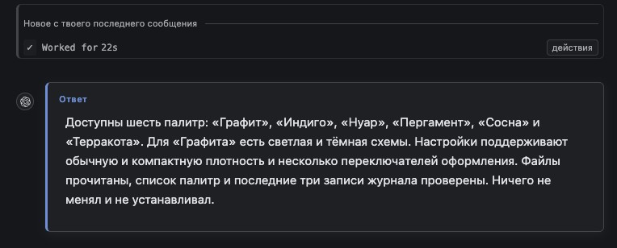
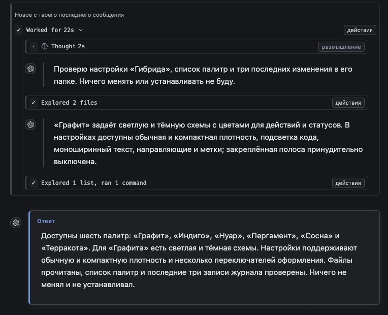
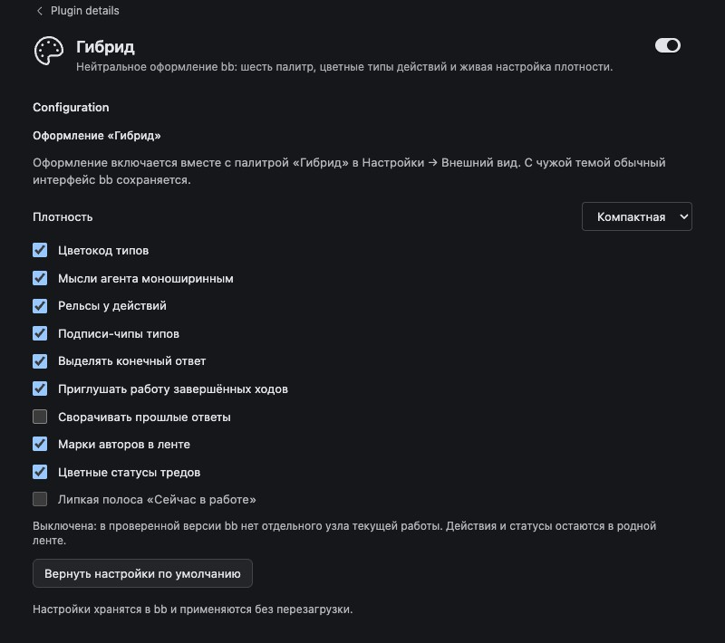

# Гибрид

## Что это

«Гибрид» — плагин оформления ленты [bb](https://getbb.app). Он разделяет сообщения пользователя, обычную речь агента, текущий ответ и итоговый ответ. Мысли и действия получают свои рельсы, цвета и подписи. Итог выделяется карточкой «Ответ», а родные статусы тредов — цветом.

Марки авторов используют значки провайдеров bb. Входящие сообщения из других тредов и системные строки о дочерних тредах получают отдельное оформление. Плагин сохраняет родные кнопки, тексты и управление bb.





Снимки ленты сделаны на отдельном демо-треде. Боковая панель и нижняя строка окружения не входят в кадр.

## Установка

Требуются **bb >=0.49** и **Plugin SDK >=0.6.132** — диапазоны из `engines` в `package.json`.

```sh
bb plugin install git:https://github.com/omiusgm/bb-plugin-hybrid
bb theme set plugin:hybrid:grafit
```

Палитру также можно выбрать в **Настройки → Внешний вид**.

## Палитры

Все шесть палитр поддерживают светлый и тёмный режимы:

- **Графит** (`grafit`) — нейтральные серые поверхности и синий акцент.
- **Терракота** (`terrakota`) — тёплые поверхности и терракотовый акцент.
- **Сосна** (`sosna`) — спокойные серо-зелёные поверхности и зелёный акцент.
- **Индиго** (`indigo`) — прохладные поверхности и сине-фиолетовый акцент.
- **Пергамент** (`pergament`) — бумажные оттенки и охристый акцент.
- **Нуар** (`nuar`) — сдержанная серая палитра с почти чёрным тёмным фоном.

Для смены подставьте нужный id:

```sh
bb theme set plugin:hybrid:grafit
```

## Настройки

Откройте **Настройки → Гибрид**. Изменения сохраняются в bb и применяются в открытых окнах без перезагрузки.

| Настройка | По умолчанию | Действие |
| --- | --- | --- |
| Плотность | Обычная | Обычные или компактные заголовки действий |
| Цветокод типов | Вкл | Разные цвета для типов действий |
| Мысли агента моноширинным | Вкл | Моноширинный шрифт мыслей |
| Рельсы у действий | Вкл | Линии слева от действий |
| Подписи-чипы типов | Вкл | Короткие подписи типов действий |
| Выделять конечный ответ | Вкл | Карточка для последней реплики завершённого хода |
| Приглушать работу завершённых ходов | Вкл | Менее заметные заголовки завершённой работы |
| Сворачивать прошлые ответы | Выкл | Сворачивает прошлые итоги; последний остаётся раскрытым |
| Марки авторов в ленте | Вкл | Значки провайдеров у реплик агента и межтредовых событий |
| Цветные статусы тредов | Вкл | Окрашивает существующие индикаторы сайдбара |
| Липкая полоса «Сейчас в работе» | Выкл, недоступна | В проверенном DOM нет отдельного узла текущей работы |



Показать настройки: `bb hybrid show`. Сбросить: `bb hybrid reset`.
Ручное раскрытие прошлого ответа сохраняется в памяти окна, без хранения текста переписки.

## Откат

Сначала верните другую тему, затем удалите плагин:

```sh
bb theme set dracula
bb plugin remove hybrid
```

Удаление плагина удаляет и его настройки. Смена на чужую тему снимает оформление «Гибрида».

## Ограничения

- Тип команды определяется эвристикой её видимого заголовка: например, `git`, `bb thread tell` или `bb thread spawn`. Это поиск подстрок, а не разбор shell. Совпадение внутри аргумента возможно. Неизвестные инструменты остаются общим типом «инструмент».
- Статус действия берётся из родного текста и индикаторов интерфейса. Галочка означает завершение строки, а не успешность всех команд внутри группы.
- У прозы в DOM нет отдельного канала `final` и надёжного атрибута завершения хода. Карточка «Ответ» определяется по границам хода, последней видимой реплике и состоянию композера. Прерванный ход отдельно от завершённого DOM не различает.
- Виртуализация ограничивает анализ смонтированной частью ленты. При неоднозначной границе плагин сохраняет раскрытие ответа и не объявляет промежуточную реплику итогом.
- Работу завершённых ходов сворачивает ядро bb по настройке провайдера. Плагин не управляет этой настройкой и не заменяет родное раскрытие.
- Цветные статусы используют только существующие индикаторы bb: работу, ожидание ввода, непрочитанный результат и ошибку. DOM не различает «принято» и «прочитано»; отдельный индикатор принятого результата не добавляется.
- Отдельного DOM-узла текущей работы нет. Липкая полоса недоступна; длительности и счётчики не подделываются.
- Марки и межтредовые события зависят от разметки и данных bb. Неизвестный провайдер не получает выдуманный логотип. Изменения DOM и экспериментального Plugin SDK могут потребовать обновления плагина.

## Проверка исходников

```sh
npm ci
npm run typecheck
npm test
npm run check:palettes
npm run build
```

Лицензия — [MIT](LICENSE).
